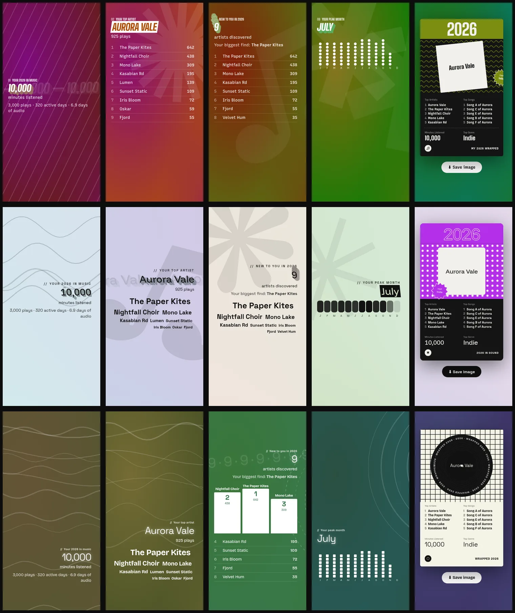

# navidrome-wrapped

Your own year-in-music recap, built from your **ListenBrainz** and/or **Last.fm** history and your **Navidrome** server. It's like Spotify Wrapped, but self-hosted.



*Each row shows the same demo data rendered with a different design seed.*

- Animated full-screen slides: minutes listened, top artists, songs, albums, genres, new artists you discovered, peak month and hour, listening streaks, and stats about your library
- Every slide plays a matching song from your own Navidrome library
- **Generated design, unique every time**: each run builds its own design from a random seed: a colour palette (always WCAG AA readable), typography from 40 bundled variable fonts, each set to a random point in its design space (weight, width, slant and custom axes such as 3D tilt, morph, bounce or optical softness) and with those axes animated, plus outline/extrude/echo/glow effects, generated entrance animations and easing curves, generated SVG decorations, and for every slide which component variant shows the data (odometer, ring, echo or ticker numbers; letter-by-letter, highlighter or marquee headlines; podium, tiles, cloud or ticker rankings; bar, dot, line, radial or heat charts) and how it's laid out
- **Generated summary card**: four layouts (year band, banner, poster, vinyl), eight frame patterns, stickers and dividers. "Save image" renders that exact card to a PNG, so what you see is what you share
- One Python file with no dependencies. The output is a static folder that works on its own (songs and covers are downloaded, so the page contains **no credentials** and you can share it safely)

## Self-host with Docker

```sh
curl -O https://raw.githubusercontent.com/Quinta0/navidrome-wrapped/main/docker-compose.yml
curl -o .env https://raw.githubusercontent.com/Quinta0/navidrome-wrapped/main/.env.example
# fill in .env, then:
docker compose up -d
```

Open http://localhost:8080. The first build takes a while (it reads your whole listening history once for the new artists card). After that, the recap regenerates every `REFRESH_HOURS` (default 24).

Or run it without compose:

```sh
docker run -d -p 8080:8080 --env-file .env -v ./data:/data ghcr.io/quinta0/navidrome-wrapped
```

## Configuration

| Variable | |
|---|---|
| `LB_USER`, `LB_TOKEN` | ListenBrainz username; the token is optional |
| `LASTFM_USER`, `LASTFM_KEY` | Last.fm username + [API key](https://www.last.fm/api/account/create) |
| `ND_URL`, `ND_USER`, `ND_PASS` | Navidrome. A LAN address is fine, since the container fetches everything it needs |
| `YEAR` | Defaults to the current year |
| `REFRESH_HOURS` | Default `24` |
| `THEME_SEED` | Keeps a look you like. Every run prints its seed (it's also in the page's `<meta name=generator>`); set this to reuse that design |

You need at least one of ListenBrainz or Last.fm. If you scrobble to both, duplicate plays are removed. Navidrome is optional, but it provides song lengths, genres, library stats, the audio and the covers.

## Sharing your recap

Each person runs their own container, pointed at their own Navidrome server. To share yours:

- **Expose it:** put the container behind your reverse proxy (Caddy, Traefik, nginx, Cloudflare Tunnel...) and send the link. Anyone who has the link can listen to the songs in your recap.
- **Send it as a file:** zip `data/site/` and send it, or upload it to any static host. It works when opened from disk.
- **Just the card:** tap "Save image" on the last slide.

## Run without Docker

```sh
export LB_USER=... ND_URL=... ND_USER=... ND_PASS=...
python3 wrapped.py --year 2026 --out wrapped   # then open wrapped/index.html
```

Requires Python 3.12+. Run the tests with `python3 test_wrapped.py`.

## Notes

- Delete `data/cache/` after importing older history, so the new artists card is recomputed.
- Songs are matched to your Navidrome library by artist and title. A slide has no audio if its song isn't in your library.
- Navidrome converts the audio to MP3 with ffmpeg, so ffmpeg must be available to your Navidrome server (the official image includes it).

## Fonts

`fonts/` contains variable fonts from Google Fonts, licensed under the [SIL Open Font License 1.1](https://openfontlicense.org) (each family's license is in `fonts/LICENSES/`). Each page embeds only the two fonts its design uses, so it works offline. To change the set, edit the lists in `scripts/fetch_fonts.py` and run it.

## License

Code: [GPL-3.0](LICENSE). Free to use, share and modify; modified versions must stay open under the same license. Bundled fonts: OFL-1.1 (see above).
